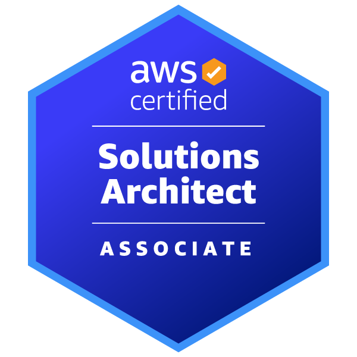

  

  
  
  

## 👋 About me

I’m **André Quispe**, a eighth-semester Software Engineering student at Universidad Tecnológica del Perú (UTP), specializing in Cloud Infrastructure, DevOps and Linux systems administration. I'm interested in technical pre-sales because it involves understanding the customer's needs, designing a solution, and clearly explaining how it would work and how much it would cost.

I’m building toward **DevSecOps** through hands-on work in cloud infrastructure, Linux Systems Administration and automation. In my labs, I administer and troubleshoot RHEL on VMware, work with Docker networking, and practice CI with GitHub Actions. My application projects span Java, Spring Boot, REST APIs and relational databases.

## 🎓 Certifications & training

### Earned certifications

  
  
  

### In preparation

- AWS Certified DevOps Engineer - Professional
- Red Hat Certified System Administrator (RHCSA, EX200)

### Completed training

- **Cisco Networking Academy** — Introduction to Networks, Switching, Routing, and Wireless Essentials, Introduction to Cybersecurity, Network Defense, and Endpoint Security.
- **Udemy** — Docker Mastery (Bret Fisher), Linux administration (Santiago Hernández), and Spring Boot (Chad Darby).

## 🛠️ Technologies & tools

### Linux, cloud & DevOps

  
  
  
  
  
  
  

- **Systems** — RHEL, Bash, users and permissions, systemd, journalctl, SSH, DNF/RPM and troubleshooting.
- **AWS** — EC2, VPC, IAM, S3, RDS, SNS and CloudWatch.
- **Containers & CI** — Docker, Docker Compose, Git and GitHub Actions.
- **Networking & virtualization** — TCP/IP, subnetting, DNS, DHCP, routing and switching, nmcli, firewalld and VMware.
- **Fundamentals** — Kubernetes and Terraform.

### Development, data & collaboration

  
  
  
  
  
  
  

- **Development** — Java, Spring Boot, JPA/Hibernate, REST APIs, OpenAPI, React and Vite.
- **Databases** — PostgreSQL, MySQL and MongoDB.
- **Collaboration** — Scrum and Jira.

## 🚀 Selected projects

| Project | What I worked on |
| --- | --- |
| **Linux/RHEL Administration Lab** | RHCSA practice in VMware covering users and permissions, systemd, networking with nmcli and firewalld, log analysis with journalctl, and backup verification with checksums. |
| [**Docker Networking Lab**](https://github.com/Andre1825/docker-networking-lab) | Connected Flask, MySQL and phpMyAdmin on a Docker Compose bridge network. Configured container DNS, a multi-stage build, health checks and persistent volumes. |
| [**TechStore**](https://github.com/Andre1825/TechStore) | Contributed to a team inventory app built with React, Java 21, Spring Boot and PostgreSQL. The project includes transactional stock tracking, permission-based access and an AWS deployment with EC2, private RDS, S3 and SNS alerts. |
| **KickStamp** ([frontend](https://github.com/ariancerna/HerramientasDesarrollo_Grupo4_Frontend) · [backend](https://github.com/ariancerna/HerramientasDesarrollo_Grupo4_Backend)) | Built filtered reports, safe CSV exports and responsive, accessible interfaces for a team attendance app. Implemented role-scoped dashboard APIs, documented them with OpenAPI, and added 17 automated tests with `node:test`. |
| [**SmartStock360**](https://github.com/Andre1825/SmartStock360) | Connected React and Spring Boot to a FastAPI service that uses a Random Forest model to forecast demand and recommend stock replenishment. |

  <a href="https://github.com/Andre1825?tab=repositories">View all public repositories →</a>

